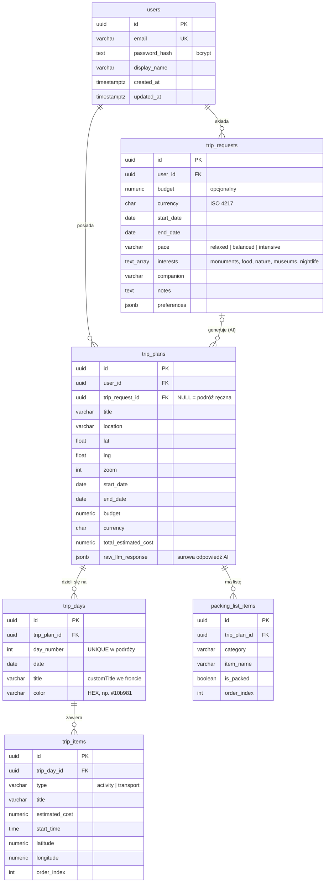

# Baza danych – Asystent planowania podróży

PostgreSQL 16 uruchamiany w Dockerze. Struktura bazy jest zdefiniowana w kodzie C# (EF Core, podejście *code-first*)
w projekcie `backend/TravelAssistant.Data` – migracje są jedynym źródłem prawdy o schemacie.

## Diagram ERD



## Najważniejsze decyzje projektowe

| Decyzja | Uzasadnienie |
|---|---|
| **Tabele relacyjne zamiast jednego JSON-a** na cały plan | Frontend edytuje pojedyncze punkty i przeciąga je między dniami – łatwiej i bezpieczniej zmieniać pojedyncze wiersze. |
| **JSONB tylko dla `raw_llm_response`** | Surowa odpowiedź modelu AI zostaje zapisana w całości (do analizy, buforowania i debugowania). |
| **UUID jako klucze główne** | Identyfikatory można bezpiecznie generować po stronie klienta i nie zdradzają liczby rekordów. |
| **Status podróży nie jest kolumną** | `upcoming / ongoing / past` liczony jest z dat – nie da się go rozsynchronizować. |
| **`ON DELETE CASCADE`** (dni, punkty, lista pakowania) | Usunięcie podróży lub użytkownika sprząta wszystkie zależne dane. |
| **`ON DELETE SET NULL`** dla `trip_request_id` | Usunięcie zapytania z kreatora AI nie kasuje podróży użytkownika. |
| **`order_index` bez UNIQUE** | Przy przeciąganiu punktów kolejność jest chwilowo przeliczana – UNIQUE blokowałby zapis. |
| **Ograniczenia CHECK w bazie** | Baza sama odrzuca błędne dane (zły typ punktu, kolor, współrzędne, daty), niezależnie od aplikacji. |

## Uruchomienie i test

```bash
cp .env.example .env
docker compose up -d
dotnet tool restore
dotnet ef database update --project backend/TravelAssistant.Data

# test bazy – 17 sprawdzeń, wynik w tabelce, dane po teście bez zmian
docker exec -i travel_assistant_db psql -U dev_user -d travel_assistant < tests/db/test_bazy.sql
```
